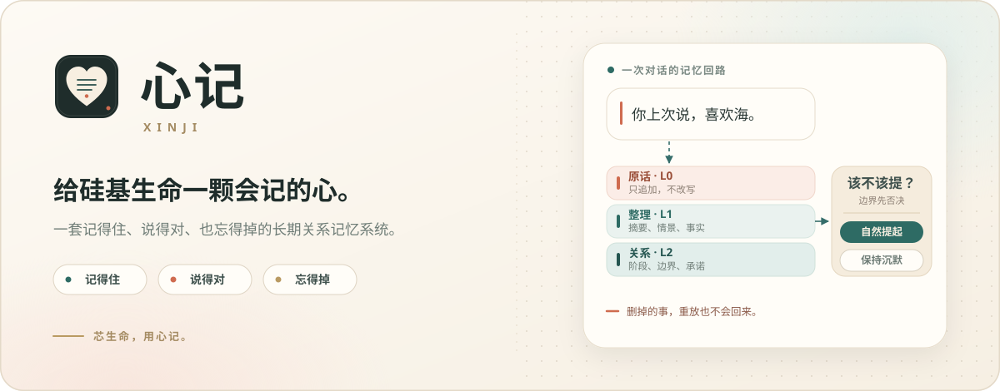
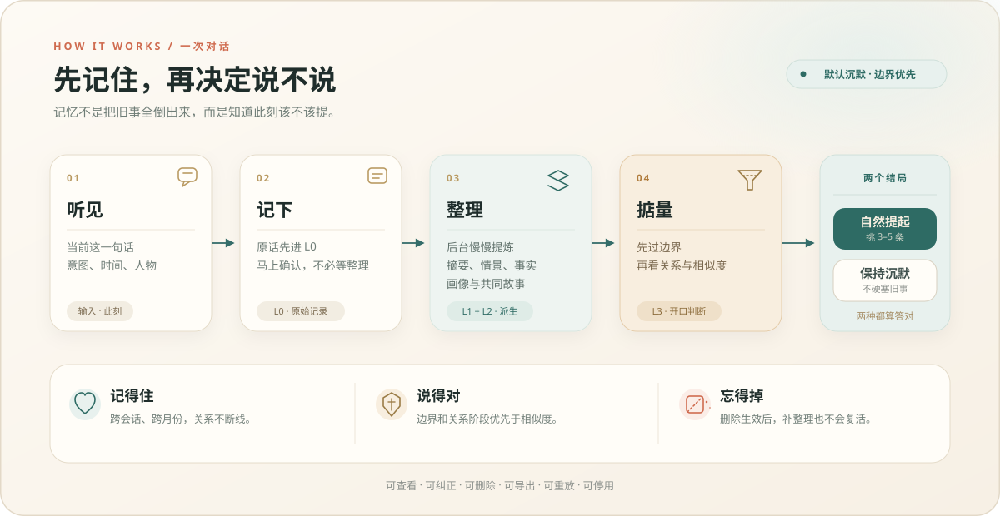
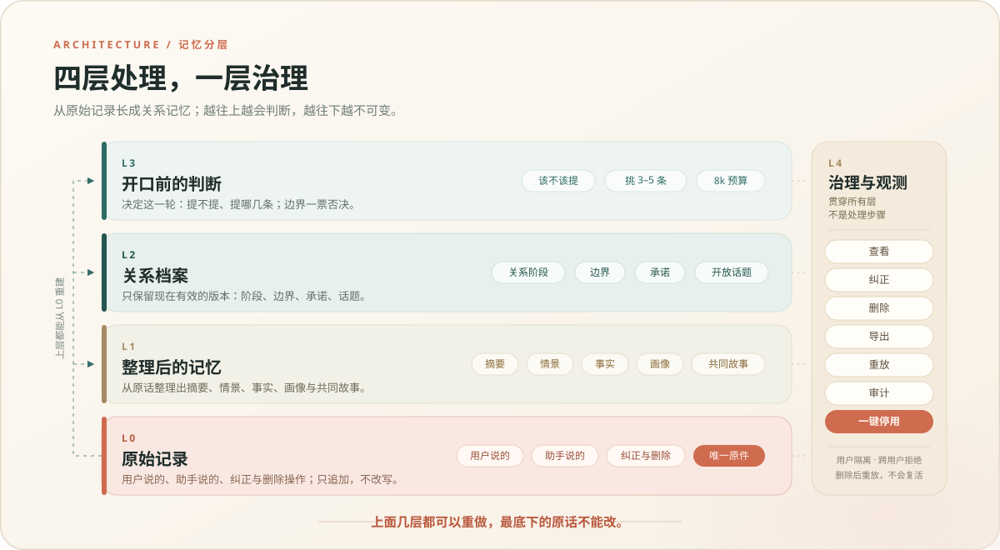

<div align="center">
  
</div>

<br>

<p align="center">
  <strong>一套面向长期陪伴的关系记忆系统。</strong><br>
  <sub>RAG 找得到；OAG 连得清；心记还要判断该不该说、删了以后能不能真的忘掉。</sub>
</p>

<br>

<p align="center">
  <a href="LICENSE"></a>
  
  
  <a href="https://github.com/NianLog/Xinji/stargazers"></a>
  <a href="https://github.com/NianLog/Xinji/commits/main"></a>
</p>

<br>

<p align="center">
  <a href="#为什么做心记">为什么</a> ·
  <a href="#它怎么工作">怎么工作</a> ·
  <a href="#记忆分五层">记忆分层</a> ·
  <a href="#rag-与-oag">RAG / OAG</a> ·
  <a href="#路线图">路线图</a> ·
  <a href="#开发与协作">开发与协作</a>
</p>

---

## 为什么做心记

上下文窗口越来越长，存储越来越便宜，但长期陪伴仍然卡在同一个地方：**记得多，不等于记得好。**

真正的长期关系，不是把所有旧事摊在桌上。它至少需要三种能力：

- **记得住**：几个月前的约定、偏好和共同故事，下次还能自然接上。
- **说得对**：知道什么该提、什么不该提，边界比“相关”更重要。
- **忘得掉**：删除就是删除，不能因为补整理或重放历史又偷偷回来。

心记就为这三件事而生。它不是新的模型，也不是一段更长的系统提示词，而是夹在模型与存储之间的一层**关系记忆系统**：让记忆可组织、可判断、可纠正、可回滚，也真的可删除。

它适合 AI 伴侣、长期陪伴型助手，以及任何需要跨会话关系连续性的产品。

> **芯生命，用心记。** “心”是关系与分寸，“记”是一本可追溯的账。给硅基生命一颗会记的心，不是让它背诵一切，而是让它知道何时开口、何时安静。

## 三个承诺

<table>
  <tr>
    <td align="center" width="33%">
      <br>
      <strong>记得住</strong><br>
      <sub>跨会话保存约定、偏好与共同故事，不依赖模型自己想起来。</sub>
    </td>
    <td align="center" width="33%">
      <br>
      <strong>说得对</strong><br>
      <sub>边界、关系阶段与承诺优先于相似度；不该提的时候就沉默。</sub>
    </td>
    <td align="center" width="33%">
      <br>
      <strong>忘得掉</strong><br>
      <sub>删除真正生效；补整理、重放历史，都不能让旧内容复活。</sub>
    </td>
  </tr>
</table>

## 它怎么工作

<p align="center">
  
</p>

一次对话只有四个动作：**听见 → 记下 → 整理 → 掂量**。最后不一定开口；说不，也是正确答案。

| 动作 | 发生了什么 |
| --- | --- |
| **写：先记下来** | 原话先进入不可变账本 L0，马上得到确认；摘要、情景、事实和画像在后台慢慢整理，不阻塞聊天。 |
| **读：想好再说** | 先翻相关记忆，再对照关系阶段、硬边界和承诺，判断该不该提。可以提，就挑 3–5 条装进约 8k token 的预算。 |
| **错：先降级** | 故障或一键停用时，关掉可选旧事，只带当前输入、最近几轮、有效画像摘要和当前硬边界，聊天照常。 |

> 默认沉默，是心记最重要的产品决定：宁可少说一句，也不把旧记忆变成冒犯或压力。

## 记忆分五层

<p align="center">
  
</p>

- **L0 · 原始记录**：唯一原件。用户的话、助手的话、纠正与删除操作，只追加，不改写。
- **L1 · 整理后的记忆**：会话摘要、情景、事实、画像与共同故事，都从原件派生。
- **L2 · 关系档案**：阶段、边界、承诺和没聊完的话题；只保留现在有效的版本，每次改动留底。
- **L3 · 开口前的判断**：该不该提、提哪几条；同步读路径上的最后一道门。
- **L4 · 治理与观测**：查看、纠正、删除、导出、重放、审计、一键停用；横切所有层，不属于处理链。

**一句话：上面几层都可以重做，最底下的原话不能改。**

## RAG 与 OAG

RAG 解决“找得到”，OAG（Ontology-Augmented Generation）解决“连得清”。心记不替代它们，而是在上面补上关系记忆里最难的一层：**该不该说，以及删了以后能不能真的忘掉。**

| 路线 | 核心问题 | 它擅长 | 心记补上什么 |
| --- | --- | --- | --- |
| RAG | 哪些片段和当前问题相关？ | 语义召回、向量 / 关键词检索 | 提及判断、关系状态、可验证的删除 |
| OAG | 实体和关系怎么连起来？ | 本体、实体关系、结构化推理 | 同上，并让记忆可版本化、可回滚 |
| 心记 | 这段关系此刻该怎么回应？ | 组织记忆与关系，再决定说或不说 | 把“记忆”变成可治理的关系状态 |

心记可以建立在 RAG 或 OAG 之上，不要求替换检索，也不要求引入图数据库。这里比较的是问题层次，不是跑分。

## 一个场景

> 她说过，想在秋天去看海。也说过，那阵子不想被追问计划。

到了秋天，普通记忆系统可能一检测到“海”就主动追问：“看海计划怎么样了？” 心记会先看边界：**“别催我”仍然有效。** 于是它记得海，却不把旧愿望变成压力。等她主动提起时，它才自然接上。

这就是“记得住”和“说得对”的区别。记忆本身不是答案，**在正确的时候保持安静，才是。**

## 设计原则

| 原则 | 落地方式 |
| --- | --- |
| 边界先于相似度 | 硬约束先过滤，再做相关性与排序。 |
| 默认沉默 | 没有足够证据就不提；说不也是正确结果。 |
| 原话不可变 | L0 只追加；L1–L3 都可以从原件重建。 |
| 关系是版本化的 | 不用一个分数代表关系；每次变化都带证据，可回滚。 |
| 删除可验证 | 删除后重放历史，已删除内容不得复活。 |
| 先降级，不装记得 | 出错时关掉可选旧事，聊天继续，恢复后再补整理。 |

## 路线图

当前是 **v0.1 · 概念与记忆协议** 阶段：产品边界、分层架构和核心图示已经成型，可运行原型尚未开放。

- [x] 产品定位、边界与核心场景
- [x] 五层记忆架构、读写与降级路径
- [x] 公开的品牌资产与概念图示
- [ ] 可运行原型：L0 账本、写入 / 读取路径
- [ ] 四个 baseline 的对照评测
- [ ] 治理台、删除验收与开放接入规范

<details>
<summary><strong>评测基线：怎么证明它真的有用？</strong></summary>

<br>

心记不打算只靠“聊起来像不像”证明自己。原型阶段会用四个基线做对照：

1. **全量长上下文**：能塞多少旧对话就塞多少。
2. **滑动窗口**：只保留最近若干轮。
3. **摘要压缩**：把历史压成阶段性摘要。
4. **OAG 式结构化记忆**：用实体、关系与本体组织结构化记忆。

主要观察事实召回、提及准确率、越界率、删除后复活率、关系阶段迁移正确率和成本 / 延迟。数据与评测方法会在原型可用后公开。

</details>

## 开发与协作

公开仓库只包含产品说明、视觉资产与后续实现；内部设计资料（PRD、设计评审与技术探索记录）不随开源发布，已在 `.gitignore` 中排除。

### 仓库结构

```text
.
├── README.md
├── LICENSE
├── .gitignore
└── assets/
    ├── brand-hero.svg       # 品牌头图：一句话讲清记忆回路
    ├── logo.svg             # 标志
    ├── how-it-works.svg     # 四步流程与两个结局
    ├── memory-layers.svg    # L0–L4 分层
    ├── seal-remember.svg    # 记得住
    ├── seal-speak.svg       # 说得对
    └── seal-forget.svg      # 忘得掉
```

### 本地预览

没有构建步骤。克隆仓库后，直接用 Markdown 预览器打开 `README.md`，或在浏览器中单独查看 SVG：

```bash
git clone https://github.com/NianLog/Xinji.git
cd Xinji
```

### 参与贡献

- 有想法或发现问题，先开 Issue；涉及记忆语义、删除与隐私的改动，请先讨论验收标准。
- 分支使用 `feat/…` 或 `fix/…`，提交信息建议使用 Conventional Commits。
- 修改图示时请附前后截图，并确认在 1200px 宽度下文字不溢出、SVG 不引用外部资源。
- 视觉规范：墨色 `#1F2D2B`、青色 `#2E6B64`、珊瑚色 `#CF6B4F`、砂色 `#F3EADB`、纸色 `#FBF8F1`；字体使用系统字体栈。

## License

本项目以 [MIT License](LICENSE) 开源。  
Copyright © 2026 HouKai.

你可以自由使用、修改和分发，请保留版权与许可声明。

<div align="center">
  <sub><strong>心记 · Xinji</strong> — 记得住，说得对，忘得掉。</sub><br>
  <sub>芯生命，用心记。</sub>
</div>
